# Mitsumete Knight R: Daibouken-hen (PlayStation) English translation v1.0

An unofficial fan translation patch for **Mitsumete Knight R: Daibouken-hen**
(みつめてナイトR 大冒険編), also known as **Mitsumete Knight R: Great Adventure**. It contains
only the changes to the game's disc image, not the game: you need your own disc image of
**Mitsumete Knight R - Daibouken-hen (Japan)** (SLPM-86134), the Redump version.

Mitsumete Knight R is a role-playing game with dating-sim mechanics. It follows Mitsumete
Knight, Konami's dating simulation of the same year, and reuses its cast in a new story. You
are the newly appointed Captain of the Royal Guard of Orcadia. The King has been poisoned, and
you set out to find the antidote with two companions chosen from five young women.

**[Download the patch (v1.0)](https://github.com/suddenlythis/mitsumete-knight-r-daibouken-hen-psx-english/releases/tag/v1.0)**
 · [How to install](INSTALL.md) · [Checksums](SHA1SUMS.txt)

  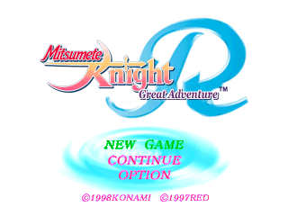

The logo in the opening movie, Japanese on the left and English on the right:

  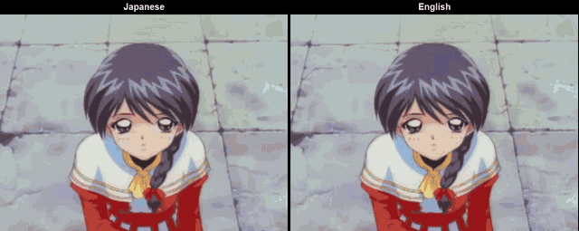

## Progress

Version 1.0: the script, the menus and the pictures with text are translated.

| Area | Status | Details |
|---|---|---|
| English text system | Done | A new English font, and room for longer lines than the Japanese text allowed |
| Dialogue and narration | Done | All of it: the story, every town, the five heroines' events and dates, the talk on the road and the endings. 18,935 pieces of text in all, menus included |
| Menus and system text | Done | Command menu, status, items, magic, equipment, shops, inns, battle, save and load, settings |
| Speaker nameplates | Done | Every nameplate, redrawn in English |
| Title and logos | Done | An English logo on the title screen. In the opening movie the logo was redrawn and animated to match the original |
| World map | Done | Place names redrawn in English |
| Name entry | Done | An English letter grid replaces the kana grid. Names of up to 7 letters |
| Staff roll | Done | In English |
| Voices | Kept | Japanese, as in the original. Voice-only lines are not subtitled. See [Not translated](#not-translated) |
| Tested on | DuckStation | |

## About the game

Mitsumete Knight R is a role-playing game from Konami, with towns, a world map, turn-based
battles and a party of three. It came out eight months after the first game, Mitsumete
Knight, a dating simulation set in a fantasy kingdom at war. R takes the same characters and
puts them in a different world and a different kind of game. It was made by a different
Konami studio, KCE Shinjuku, with the series' general producer and original character
designs carried over from the first game.

| | |
|---|---|
| Released | 26 November 1998, Japan only |
| Publisher | Konami |
| Developer | KCE Shinjuku (Konami Computer Entertainment Shinjuku) with Red Company |
| Product code | SLPM-86134 |
| Earlier game | Mitsumete Knight, 19 March 1998 ([English patch](https://github.com/suddenlythis/mitsumete-knight-psx-english)) |

**The story.** In the Kingdom of Orcadia, the Captain of the Royal Guard is struck down by an
unknown attacker and you are promoted in his place. General Kurgan hands you a mission that
has passed from captain to captain for fifteen years: find Kingsbane, a sword lost in an old
uprising. Before you can start, the King collapses, poisoned. The High Priest's divination
names the antidote, the Star Tear, and says that reaching it needs two heirs to a jewel
called the Tear of Time. Five people in the capital own one.

**The heroines.** Sophia, Hanna, Raizze, Lesley and Linda are the five heirs. You take two of
them with you, and the choice changes what happens on the way.

**How it plays.** Your two companions follow you around on screen in towns and dungeons. You
travel between towns on a world map, talk to your companions on the road, and fight
turn-based battles with weapons, magic and attacks made together with a
companion. On the Sabbath a companion may ask you out for the day. Where you go, how you
answer and which clothes you pick for her change how she feels about you. Clothes bought on
dates can be worn.

**Gaze.** "Gaze" is the game's みつめて (*mitsumete*), the word in the series title. It is the
last icon on the equipment screen, the magnifying glass: it shows a companion full length in
what she is wearing, and she reacts to being stared at, differently depending on how she
feels about you. The D-pad moves the pointer, Circle confirms and Cross goes back. Her
reactions are spoken only, so they have no English text. Gaze can be switched off under
Settings in the menu: the icon is then dimmed and cannot be selected.

**More than one playthrough.** The game is made to be played several times. Odd and even
playthroughs differ in items, costumes and ending, and affection and clothes carry over.

- **Your companions change the story.** You pick two of five heroines at the start, and who
  is with you changes scenes, conversations and events all the way through. One of them can
  be swapped along the way.
- **It is almost fully voiced.** About 6,600 lines of dialogue are spoken.
- **The journey is the courtship.** Your companions talk to you on the road between towns,
  react to how battles went, and ask you out on the Sabbath, with a date written for nearly
  every town you pass through.
- **Clothes matter.** There are over 140 pieces of clothing to find, buy on dates and earn.
  What a companion wears shows on her portrait, and she has opinions about it.
- **Fighting together counts.** Battles are quick and turn-based, and companions who like
  you enough join you in combined attacks.
- **It is funny.** The script is full of jokes, running gags and nods to films, anime and
  other games, next to a story that takes itself seriously when it needs to.
- **It rewards a second playthrough.** Odd and even playthroughs differ in items, costumes
  and ending, affection and clothes carry over, and the full ending only comes the second
  time round.
- **Thirteen animated scenes**, an album of souvenir photos, and a hidden room left by the
  developers for those who finish it.

### How it differs from the first Mitsumete Knight game

You do not need to have played the first game. R is not a sequel to its story: it reuses the
cast in another world, so the same faces turn up in new roles.

| | Mitsumete Knight | Mitsumete Knight R |
|---|---|---|
| Kind of game | Dating simulation with battles | Role-playing game with dating-sim mechanics |
| Setting | The Kingdom of Dolphan, at war | The Kingdom of Orcadia, a different world |
| You are | A foreign mercenary | The Captain of the Royal Guard |
| Structure | Three years on a calendar, planning each week and training your stats | A journey from town to town on a world map, with levels and equipment |
| Heroines | Sixteen, met around the capital | Five travel with you (Sophia, Hanna, Raizze, Lesley, Linda), two at a time, and are with you in every scene. Others from the first game appear in new roles |
| Battles | Army battles in formation, and duels | Turn-based party battles with magic and combined attacks with your companions |
| Courtship | Visits, invitations and dates through the year | Dates on the Sabbath, talk on the road, and clothes to choose for her |
| Extras | Mini-games at the festivals, a newspaper and a glossary | Costumes and the Gaze view, an album of souvenir photos, and a changed story on the second playthrough |

## Screenshots

| | |
|---|---|
| 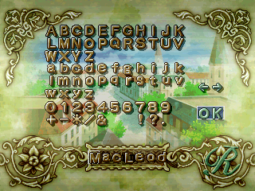 | 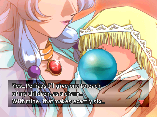 |
| 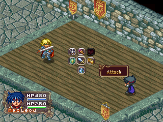 | 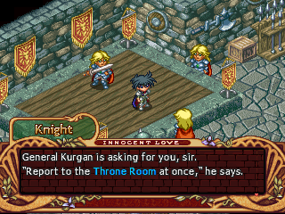 |
| 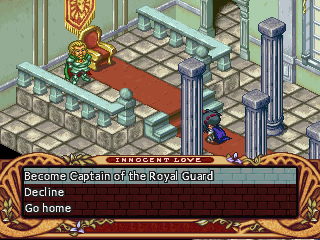 | 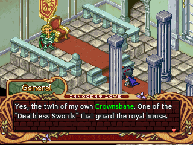 |
| 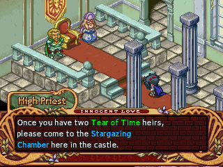 | 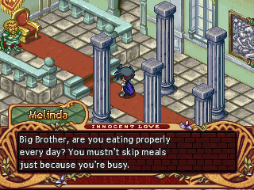 |
| 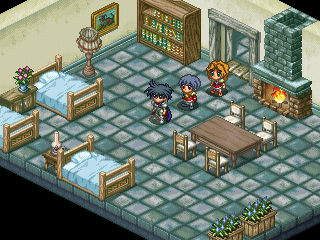 | 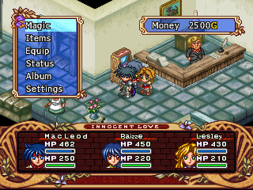 |
| 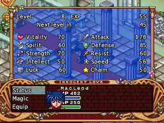 | 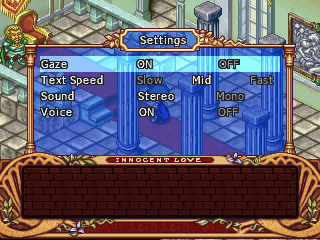 |
| 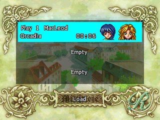 | 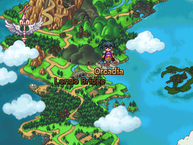 |
| 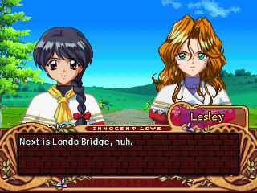 | 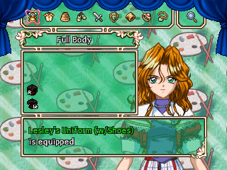 |
| 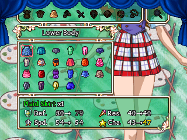 | 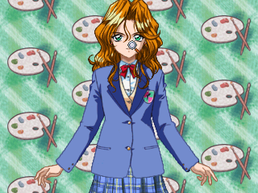 |
| 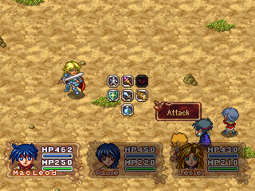 | 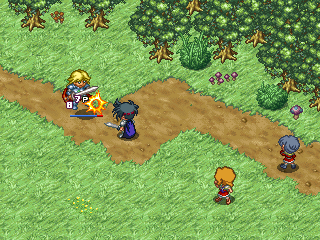 |
| 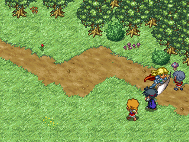 | 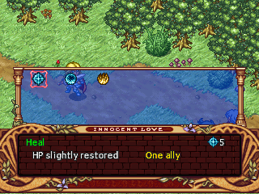 |
| 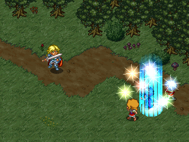 | 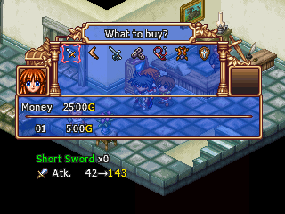 |
| 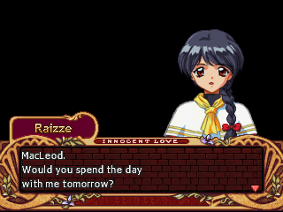 | 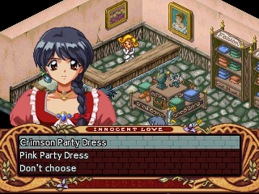 |
| 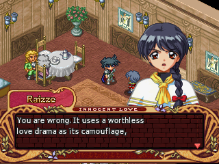 | 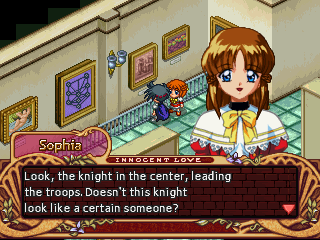 |
| 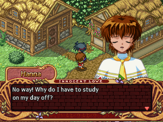 | 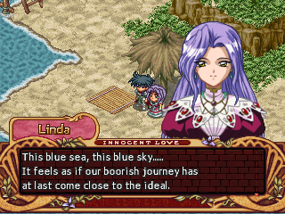 |
| 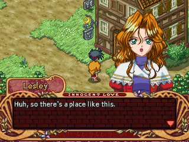 | 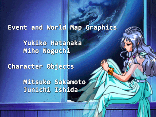 |

## Installing

You need the Redump version of the disc, **Mitsumete Knight R - Daibouken-hen (Japan)**
(SLPM-86134): one `.cue` and one `.bin`. The `.bin` must be 747,764,304 bytes with SHA-1
`4f4f9aadbe78d00b4b71c026325b5c59d6c82bd6`.

Short version: patch `Mitsumete Knight R - Daibouken-hen (Japan).bin` with the `.xdelta`
file, keep the file name, and open your usual `.cue`.

The full steps, for Delta Patcher and for the command line, are in [INSTALL.md](INSTALL.md).

Start a new game after patching. A save made with the Japanese game stores the hero's name in
Japanese letters, which the English game cannot show properly.

## About this translation

**Tone.** The script keeps the tone of the original, including its crude jokes, innuendo and
blunt wording. Nothing has been toned down and nothing made harsher.

**Names.** Characters and terms follow the
[Mitsumete Knight English translation](https://github.com/suddenlythis/mitsumete-knight-psx-english),
which uses the spellings Konami printed in the manuals and the official guidebook: Sophia,
Hanna, Raizze, Lesley, Linda, Priscila. "Orcadia" and the hero's default name, Christopher
MacLeod, are printed in this game's own manual.

**Voices.** Voiced lines that appear as text are translated.

AI was used to assist with the code and translation.

## What is in English

- All dialogue and narration: the story, every town and its people, the heroines' events and
  dates, the talk on the road, the letters and every ending.
- Menus and system messages: the command menu, status, items, magic, equipment, shops, inns,
  battle, save and load, settings.
- Item, weapon, costume, spell and monster names and their descriptions.
- The name-entry screen, as an English grid.
- Pictures with text, redrawn in English: the title logo, the speaker nameplates, the place
  names on the world map, the battle command labels and the staff roll.
- The logo in the opening movie: redrawn in English and animated, so that it fades in,
  glows and sparkles as the Japanese logo does.

## What was changed in the game

Nothing about the rules, the story or the content was changed.

- The game's text is drawn with a new English font, and lines hold more letters than the
  Japanese text did.
- English text is longer than the Japanese, so the scripts were rebuilt and re-paged to fit.
- The name-entry screen uses an English grid. The hero's name can be up to 7 letters.

## Not translated

- Voice-only lines are not subtitled. These are lines the game speaks without showing any
  text: the greeting when you start or continue a game, the memory-card warnings, each heroine's reactions on
  the equipment screen, battle shouts, Melinda reading her letters aloud (the letter text
  itself is translated), and the voices in the movies.
- One piece of scenery: three hanging scrolls with one brush character each in a
  training-hall map.

## Technical

- One file of the disc image is changed, the `.bin`. It stays the same size.
- The patch is made against the Redump image (SHA-1
  `4f4f9aadbe78d00b4b71c026325b5c59d6c82bd6`) and refuses any other file.
- Emulator save states made on the Japanese game keep the old program and text in memory.
  Load the game normally instead.

## Version history

| Version | Date | Notes |
|---|---|---|
| v1.0 | 2026-11-26 | First release. Full script, menus, English name entry, nameplates, title and movie logos, world map names and staff roll |

Bug reports are welcome in the Issues tab.

---

This is an unofficial, non-commercial fan work. Mitsumete Knight R and everything in it belong
to their owners. The patch contains no game data that can be used without an original disc
image.
